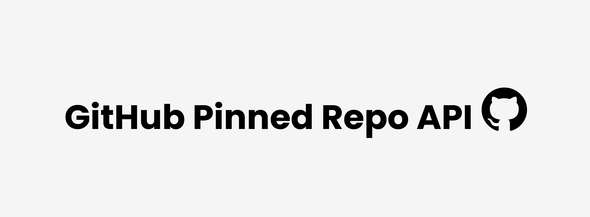

# GitHub Pinned Repo API


[](#) &nbsp;
[](#) &nbsp;
[](#) &nbsp;
[](#) &nbsp;
[](#) &nbsp;
[](LICENSE) &nbsp;
[](https://github.com/alvinau0427/github-pinned-repo-api/actions/workflows/ci.yml) &nbsp;

> A TypeScript API that retrieves pinned repositories from a GitHub profile without requiring a personal access token. **GraphQL is used when a token is configured; a robust scraper is used otherwise.**

## 📢 Important Notices
> [!IMPORTANT]
> The public Render instance at `https://github-pinned-repo-api.onrender.com` is best-effort. For production use, self-host this instance.

> [!NOTE]
> **API compatibility:** `GET /api/:username` keeps its original path, method and response fields. New fields are additive only. CORS still defaults to `*`.

## 🚀 Overview
Two ways to use it:
1. **Interactive UI** — open `/`, type a username, and results are rendered on the same page.
2. **Plain API** — call `GET /api/:username` and receive raw JSON (unchanged, safe to embed in other projects).

## ✨ Features
- **RESTful routing**: `GET /api/:username`.
- **Interactive API docs**: Swagger UI at `/docs`.
- **Dual-mode fetching**: GitHub GraphQL API with automatic scraper fallback.
- **Consistent metadata**: `topics`, `isArchived`, `isFork`, `parentRepo` and `website` are available in both modes.
- **Resilient scraper**: multiple selector strategies, timeout + backoff, and repo-metadata cache.
- **Caching**: LRU cache (5 min TTL) with stale-while-revalidate background refresh.
- **Cache semantics**: `Cache-Control` and `X-Cache: HIT|MISS` response headers.
- **Safety**: username validation (422), rate limiting (429, configurable), graceful upstream errors.
- **Frontend**: same-page results with loading / error / empty states, shareable `?q=` URL, and an **API endpoint bar** with Copy / Open JSON actions.
- **Token verification**: startup log clearly reports whether GraphQL is active or the scraper fallback is being used.
- **CI**: GitHub Actions runs `npm run build` and `npm test` on every push / PR.

### UI controls
- **Search**: type a GitHub username and press Enter (or click the arrow).
- **API endpoint bar**: shows `GET /api/{username}` for the current result — **Copy** the full URL or **Open JSON** in a new tab.
- **Need help? How to use →**: toggles the 3-step guide; the label becomes **Hide guide** while open.
- **Logo**: resets everything and returns to the initial state (`?q=` removed, input cleared, guide restored, input focused).
- **✕ in the input**: clears only the text, keeping the current results on screen.
- **Footer**: Swagger docs, source link, limits note and copyright are always visible.

## 🛠️ Tech Stack
TypeScript · Node.js / Express · Tailwind CSS (compiled, no CDN) · Cheerio · lru-cache · Swagger · node:test + supertest

## 📖 API Documentation
**[View Interactive Swagger Docs](https://github-pinned-repo-api.onrender.com/docs)**

### Endpoint
```
GET /api/:username
```

### Example Request
```
https://github-pinned-repo-api.onrender.com/api/alvinau0427
```

### Example Response
```json
[
  {
    "owner": "alvinau0427",
    "repo": "github-pinned-repo-api",
    "link": "https://github.com/alvinau0427/github-pinned-repo-api",
    "description": "Get GitHub pinned repository contents without using personal access token",
    "image": "https://opengraph.githubassets.com/1/alvinau0427/github-pinned-repo-api",
    "website": "https://github-pinned-repo-api.onrender.com",
    "language": "TypeScript",
    "languageColor": "#3178c6",
    "stars": 1,
    "forks": 0,
    "isArchived": false,
    "isFork": false,
    "topics": ["api", "github-api", "github-pinned-repos"]
  }
]
```

> [!NOTE]
> - `parentRepo` only appears when `isFork` is `true`.
> - A user with no pinned repositories returns `[]`.
> - Errors return `{ "error": string, "status": number }` with 404 / 422 / 429 / 500 / 502 / 504.

## 🛠️ Usage
### Installation
```
npm install
```

### Environment Setup
Create a `.env` file in the root directory (all optional):
```
GITHUB_TOKEN=your_personal_access_token
APP_URL=http://localhost:3000
ALLOWED_ORIGINS=http://localhost:3000,https://your-domain.com
RATE_LIMIT_MAX=300
PORT=3000
```
- `GITHUB_TOKEN` — enables GraphQL mode; without it the scraper is used.
- `ALLOWED_ORIGINS` — when omitted, CORS allows all origins (backwards compatible).
- `RATE_LIMIT_MAX` — requests per minute per IP on `/api` (default `300`).

### Build & Start
```
npm install
npm run build
npm start
```

### Development
```
npm run dev
```

### Tests
```
npm test
```

## 📁 Project Structure
```
src/
├── client/                 # Frontend logic (fetch + render)
├── server/
│   ├── app.ts              # Entry point, cron keep-alive
│   ├── server.ts           # Express app, routes, cache, rate limit
│   ├── swagger.ts          # OpenAPI spec
│   ├── errors.ts           # HttpError
│   ├── http.ts             # fetch with timeout / retry
│   ├── services/
│   │   └── pinnedRepos.ts  # GraphQL + mode selection
│   └── scraper/
│       ├── index.ts        # Scraping orchestration
│       ├── parseProfile.ts # Pinned list parser
│       └── parseRepo.ts    # Website / topics / archived parser
├── view/                   # HTML template
├── assets/                 # CSS, images
├── types.ts                # Shared interfaces
└── manifest.json           # PWA manifest
tests/                      # Parser + API regression tests
```

## 🎯 Use Cases
- Developer portfolios
- GitHub dashboards
- Static-site integrations (Astro, Next.js, Eleventy)

## License
Released under the [MIT License](LICENSE). Copyright (c) 2026 Alvin Au.
