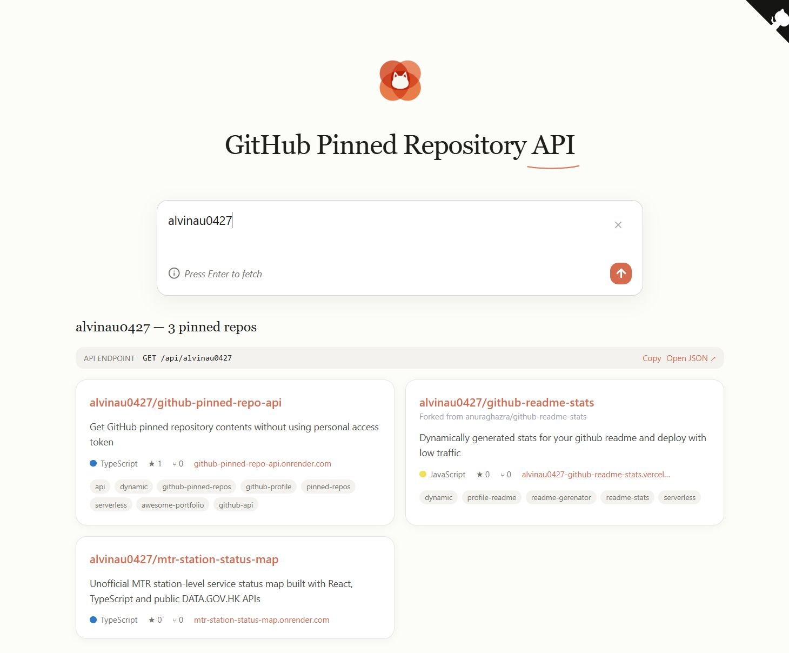

# GitHub Pinned Repo API


[](https://github.com/alvinau0427/github-pinned-repo-api/actions/workflows/ci.yml) &nbsp;
[](LICENSE) &nbsp;
 &nbsp;
[](https://github-pinned-repo-api.onrender.com/docs)

**Read any GitHub profile's pinned repositories without a personal access token.**

No token required · 5-min cache · 300 req/min



[Live demo](https://github-pinned-repo-api.onrender.com) · [Swagger docs](https://github-pinned-repo-api.onrender.com/docs) · [Example response](#example-response)

## Why this exists

GitHub requires a personal access token to read someone's pinned repositories through its API. This API does not. Give it a username and it returns pinned repos with consistent metadata, using GraphQL when a token is configured and a scraper otherwise.

Open `/` and type a username for results on the same page, or call `GET /api/:username` for raw JSON that is safe to embed in other projects.

## Quickstart

```bash
git clone https://github.com/alvinau0427/github-pinned-repo-api.git
cd github-pinned-repo-api
npm install
npm run build
npm start
```

Then open `http://localhost:3000/` for the UI or `http://localhost:3000/api/alvinau0427` for JSON. No `.env` file is needed to start.

To try the hosted API without installing:

```bash
curl https://github-pinned-repo-api.onrender.com/api/alvinau0427
```

## What you get

**Fetching**

- GitHub GraphQL API with automatic scraper fallback. Both modes return the same fields: `topics`, `isArchived`, `isFork`, `parentRepo` and `website`.
- The scraper uses multiple selector strategies, timeout + backoff, and a repo-metadata cache.
- The startup log reports whether GraphQL is active or the scraper fallback is in use.

**Caching**

- LRU cache with a 5 min TTL and stale-while-revalidate background refresh.
- `Cache-Control` and `X-Cache: HIT|MISS` response headers.

**Safety**

- Username validation returns 422. Rate limiting returns 429 and is configurable, with a default of 300 requests per minute per IP on `/api`.
- Upstream failures return 404 / 500 / 502 / 504.

**Frontend**

- Same-page results with loading, error and empty states, a shareable `?q=` URL, and an API endpoint bar with Copy / Open JSON actions.
- Swagger UI at `/docs`.

### UI controls

- Type a GitHub username and press Enter or click the arrow to search.
- The API endpoint bar shows `GET /api/{username}` for the current result. Copy the full URL or open the JSON in a new tab.
- The **Need help? How to use →** label toggles the 3-step guide and becomes **Hide guide** while open.
- Click the logo to reset everything: `?q=` is removed, the input is cleared, the guide is restored and the input is focused.
- The ✕ in the input clears only the text and keeps the current results on screen.
- The footer keeps Swagger docs, the source link, the limits note and the copyright visible.

## Use cases

- Developer portfolios
- GitHub dashboards
- Static-site integrations (Astro, Next.js, Eleventy)

Embed the endpoint with one fetch call:

```js
const repos = await fetch(
  'https://github-pinned-repo-api.onrender.com/api/alvinau0427'
).then((res) => res.json())
```

## API

**[View Interactive Swagger Docs](https://github-pinned-repo-api.onrender.com/docs)**

### Endpoint

```
GET /api/:username
```

### Example request

```
https://github-pinned-repo-api.onrender.com/api/alvinau0427
```

### Example response

```json
[
  {
    "owner": "alvinau0427",
    "repo": "github-pinned-repo-api",
    "link": "https://github.com/alvinau0427/github-pinned-repo-api",
    "description": "Get GitHub pinned repository contents without using personal access token",
    "image": "https://opengraph.githubassets.com/1/alvinau0427/github-pinned-repo-api",
    "website": "https://github-pinned-repo-api.onrender.com",
    "language": "TypeScript",
    "languageColor": "#3178c6",
    "stars": 1,
    "forks": 0,
    "isArchived": false,
    "isFork": false,
    "topics": ["api", "github-api", "github-pinned-repos"]
  }
]
```

- `parentRepo` only appears when `isFork` is `true`.
- A user with no pinned repositories returns `[]`.
- Errors return `{ "error": string, "status": number }` with 404 / 422 / 429 / 500 / 502 / 504.

## Configuration

Create a `.env` file in the root directory. All variables are optional:

```
GITHUB_TOKEN=your_personal_access_token
APP_URL=http://localhost:3000
ALLOWED_ORIGINS=http://localhost:3000,https://your-domain.com
RATE_LIMIT_MAX=300
PORT=3000
```

- `GITHUB_TOKEN` enables GraphQL mode. Without it, the scraper is used.
- `ALLOWED_ORIGINS` — when omitted, CORS allows all origins (backwards compatible). CORS still defaults to `*`.
- `RATE_LIMIT_MAX` — requests per minute per IP on `/api` (default `300`).

## Development

```bash
npm run dev
```

```bash
npm test
```

GitHub Actions runs `npm run build` and `npm test` on every push and PR.

## Project structure

```
src/
├── client/                 # Frontend logic (fetch + render)
├── server/
│   ├── app.ts              # Entry point, cron keep-alive
│   ├── server.ts           # Express app, routes, cache, rate limit
│   ├── swagger.ts          # OpenAPI spec
│   ├── errors.ts           # HttpError
│   ├── http.ts             # fetch with timeout / retry
│   ├── services/
│   │   └── pinnedRepos.ts  # GraphQL + mode selection
│   └── scraper/
│       ├── index.ts        # Scraping orchestration
│       ├── parseProfile.ts # Pinned list parser
│       └── parseRepo.ts    # Website / topics / archived parser
├── view/                   # HTML template
├── assets/                 # CSS, images
├── types.ts                # Shared interfaces
└── manifest.json           # PWA manifest
tests/                      # Parser + API regression tests
```

## Limits

> [!IMPORTANT]
> The public Render instance at `https://github-pinned-repo-api.onrender.com` is best-effort. For production use, self-host this instance.

> [!NOTE]
> `GET /api/:username` keeps its original path, method and response fields. New fields are additive only.

## License

Released under the [MIT License](LICENSE). Copyright (c) 2026 Alvin Au.
